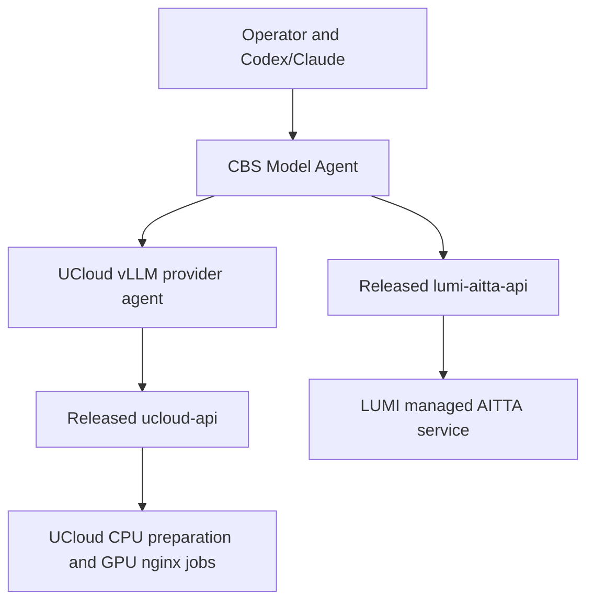

# Provider boundaries

The wrapper selects the provider and preserves its semantics. UCloud's provider
is an agent workspace with deterministic inspection, sizing, profiles, preparation,
verification and lifecycle. It remains independently usable. LUMI's API package is
a generic control client; the wrapper owns its conversational model-use workflow
and chat verification. A separate LUMI agent repository is unnecessary for this
initial managed-service integration.

There is no provider-to-provider dependency. The wrapper's optional extras pin
released packages. Install either provider alone or both. Do not infer UCloud
machine requirements or pinned revisions from a managed AITTA model identifier.
Do not assume a model/capability exists on both platforms.

UCloud retains its existing workspace and `.env`; `--workspace` makes that boundary
explicit. AITTA reads the wrapper environment or an explicit existing `--env-file`.
Credentials and deployment journals are not copied during migration. Provider
submissions and task evidence remain owned by their actual execution path.

This separation moves AITTA out of ucloud-vllm-agent without changing its tested
UCloud lifecycle. The LUMI API remains at v0.1.0. The wrapper starts with explicit
provider namespaces; unified planning, cross-provider benchmarks and task catalogs
can be added when their contracts and evidence are established.
