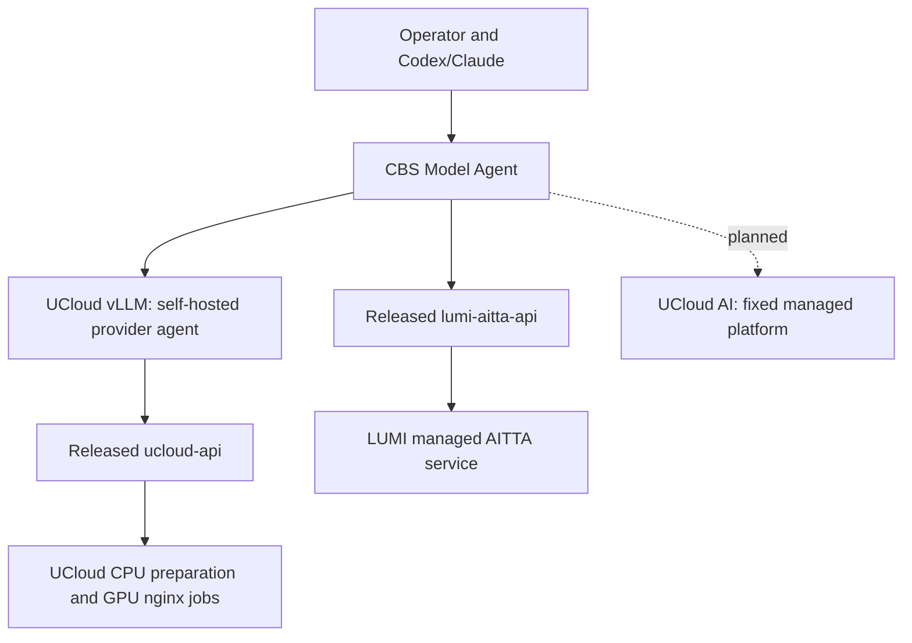

# Provider boundaries

The wrapper selects the provider and preserves its semantics. UCloud's provider
is an agent workspace with deterministic inspection, sizing, profiles, preparation,
verification and lifecycle. It remains independently usable. LUMI's API package is
a generic control client; the wrapper owns its conversational model-use workflow
and chat verification. A separate LUMI agent repository is unnecessary for this
initial managed-service integration.

The self-hosting provider ID and CLI namespace are `ucloud-vllm`. The separate
[UCloud AI platform](https://ai.escience.sdu.dk/) is a future managed provider
with reserved ID `ucloud-ai`. Its listing is a roadmap item, not an implemented
adapter or tested API. Review access, model catalog, authentication and task
contracts before introducing that integration. Never route its requests to
UCloud vLLM simply because both platforms have UCloud in their names.

There is no provider-to-provider dependency. The wrapper's optional extras pin
released packages. Install either provider alone or both. Do not infer UCloud
machine requirements or pinned revisions from a managed AITTA model identifier.
Do not assume a model/capability exists on both platforms.

UCloud retains its existing workspace and `.env`; `--workspace` makes that boundary
explicit. AITTA reads the wrapper environment or an explicit existing `--env-file`.
Credentials and deployment journals are not copied during migration. Provider
submissions and task evidence remain owned by their actual execution path.

AITTA remains outside ucloud-vllm-agent. The LUMI AITTA API is pinned at v0.1.0;
the released wrapper v0.1.3 consumes UCloud provider v0.1.5. The wrapper uses explicit
provider namespaces; unified planning, cross-provider benchmarks and task catalogs
can be added when their contracts and evidence are established.

The independent lumi-api repository manages SSH/Slurm jobs on LUMI. It is not
the AITTA client, an inference provider here, or a dependency required for AITTA
onboarding. Researcher setup paths and pilot acceptance are in
[onboarding](researcher-onboarding.md) and the [pilot plan](onboarding-plan.md).
